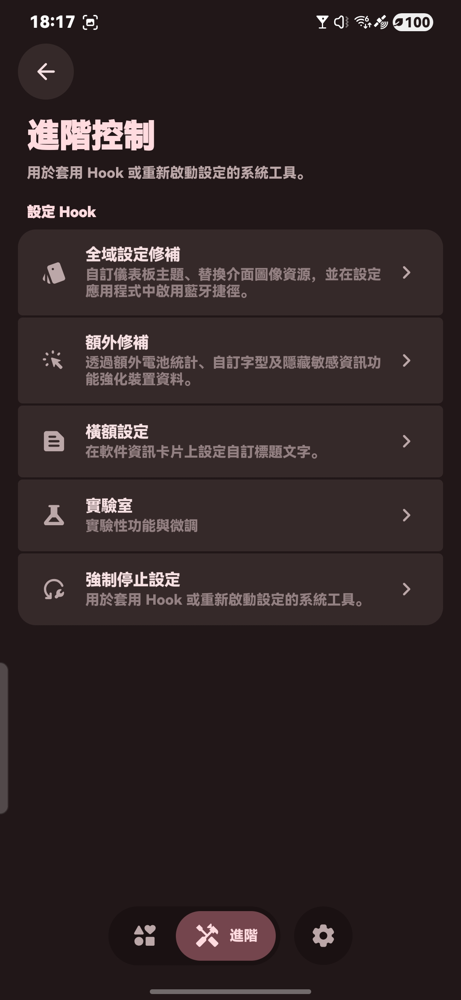
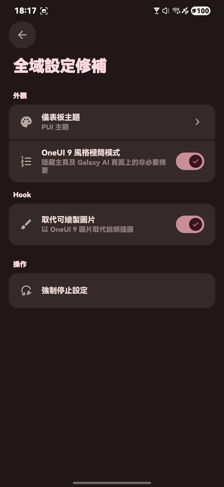
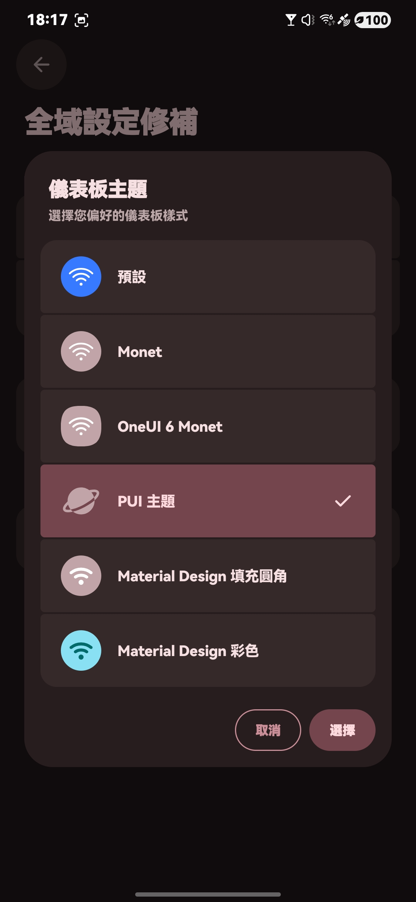
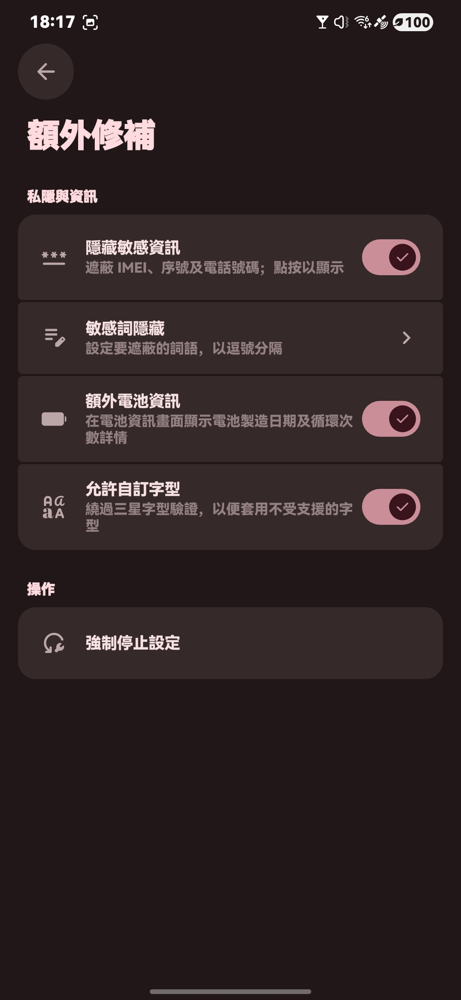
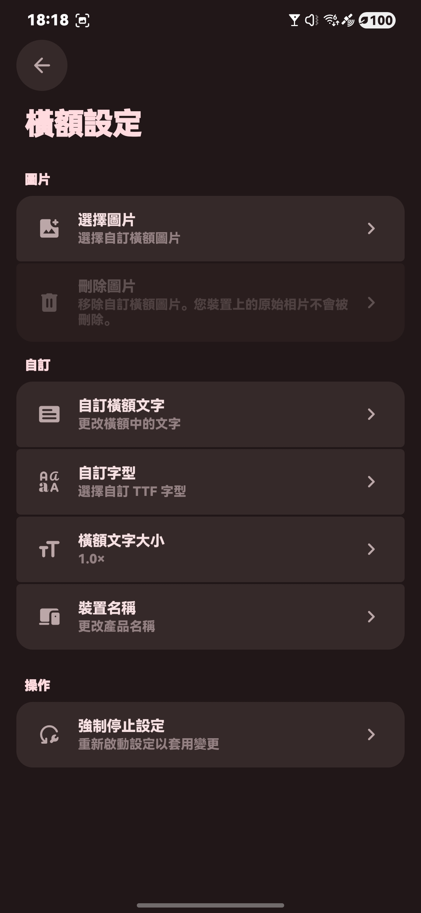
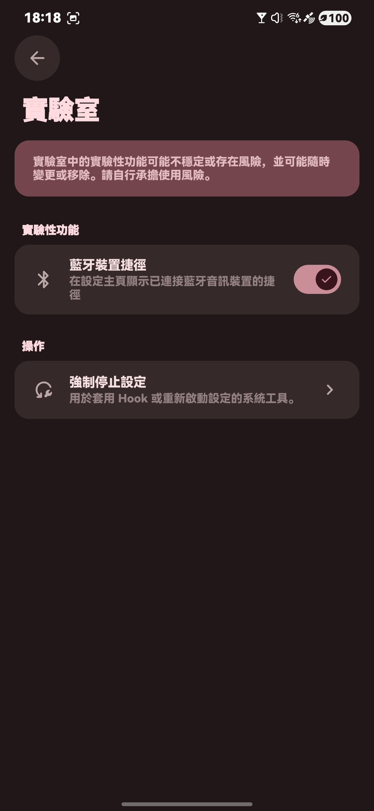

[English](README.md) · **繁體中文**

---

> 本項目已全面轉為閉源。若您認為應用必須開源，建議您離開本頁，以免產生不適。開發者並無義務將自身應用代碼開源。

---

# OneUI-Settings-Hook

> 適用於 `One UI 7 及以上`

> 針對 One UI 7+ 設定應用程式的修補模組

## 需求

> 需要 Root 權限

> 需要 LSPosed 2.0.0 或更新版本

> 已在 One UI 7 ~ 9 上測試

## 功能

> ‼️ 重新設計的軟體資訊頁面
>
> - 文字動畫
> - 自訂橫幅文字、自訂字型與文字大小
> - 自訂橫幅圖片（可選擇/刪除；備用桌布）
> - 新橫幅樣式 / 重新設計的軟體卡片
> - 自訂產品名稱
> - 軟體資訊卡片背景使用主畫面桌布

> 🎨 自訂儀表板圖示
>
> - OneUI Monet
> - OneUI 6 Monet
> - PUI 主題
> - MD 主題（Material Design 填充圓角 / 彩色）

> 🔒 隱藏敏感資訊
>
> - 自動隱藏 / 遮蔽以下資訊；點按以顯示：
>   - IMEI
>   - 序號
>   - 電話號碼

> 🔤 允許自訂字型
>
> - 繞過三星字型驗證
> - 支援自訂字型 APK

> 📦 可複製所有應用程式
>
> - 繞過 Dual Messenger / App Copy 限制

> 🔋 額外電池資訊
>
> - 在電池資訊畫面顯示電池製造日期與充電循環次數詳細資料

> 🧩 更多設定修補
>
> - 以 One UI 9 圖片取代說明插圖
> - 設定首頁的藍牙裝置捷徑
> - One UI 9 風格極簡模式（隱藏首頁與 Galaxy AI 頁面上的非必要摘要）
> - 停用更新應用程式
> - 強制停止設定捷徑

> 🌐 多語言介面
>
> - 跟隨系統或選擇 English、日本語、한국어、Tiếng Việt、繁體中文（香港/台灣）、简体中文、偽中國語、粵語、粵語（簡體）等

## 螢幕截圖

  
  
  
  

  
  
  
  
  

- 已套用 One UI Settings Hook 的 One UI 8 螢幕截圖

## 下載

從 [Releases 頁面](https://github.com/HeheJuice/OneUI-Settings-Hook/releases) 下載最新 APK。

亦可透過 [LSPosed 模組儲存庫](https://github.com/Xposed-Modules-Repo/com.HeheJuice.OneUISettingsHook/releases) 取得。

本應用程式僅以編譯後的 APK 形式發佈，不提供原始碼。

## 授權與隱私

> [授權條款（EULA）](LICENSE)
>
> [隱私權政策](Privacy_Policy.txt)

> [!NOTE]
> 使用或轉發本內容時，您必須同意並遵守這些條款。

## 致謝

<table>
  <tbody>
    <tr>
      <td width="56" align="center" valign="middle">
        
      </td>
      <td valign="middle">
        <a href="https://github.com/HeheJuice"><b>HeheJuice</b></a> 
        此應用程式的開發者
      </td>
    </tr>
    <tr>
      <td width="56" align="center" valign="middle">
        
      </td>
      <td valign="middle">
        <a href="https://github.com/MiToverG422"><b>MiToverG422</b></a> 
        Monet 配色協助
      </td>
    </tr>
    <tr>
      <td width="56" align="center" valign="middle">
        
      </td>
      <td valign="middle">
        <a href="https://t.me/PUINewsroom"><b>FifthSnow</b></a> 
        PUI 主題設計師
      </td>
    </tr>
    <tr>
      <td width="56" align="center" valign="middle">
        
      </td>
      <td valign="middle">
        <a href="https://github.com/dotarma"><b>Dotarma</b></a> 
        越南語協助
      </td>
    </tr>
    <tr>
      <td width="56" align="center" valign="middle">
        
      </td>
      <td valign="middle">
        <a href="https://github.com/material-components"><b>Material Components</b></a> 
        此應用程式使用的 Material Design 元件
      </td>
    </tr>
    <tr>
      <td width="56" align="center" valign="middle">
        
      </td>
      <td valign="middle">
        <a href="https://github.com/google"><b>Google</b></a> 
        此應用程式使用的 Material Design 圖示
      </td>
    </tr>
  </tbody>
</table>

## 加入我們

