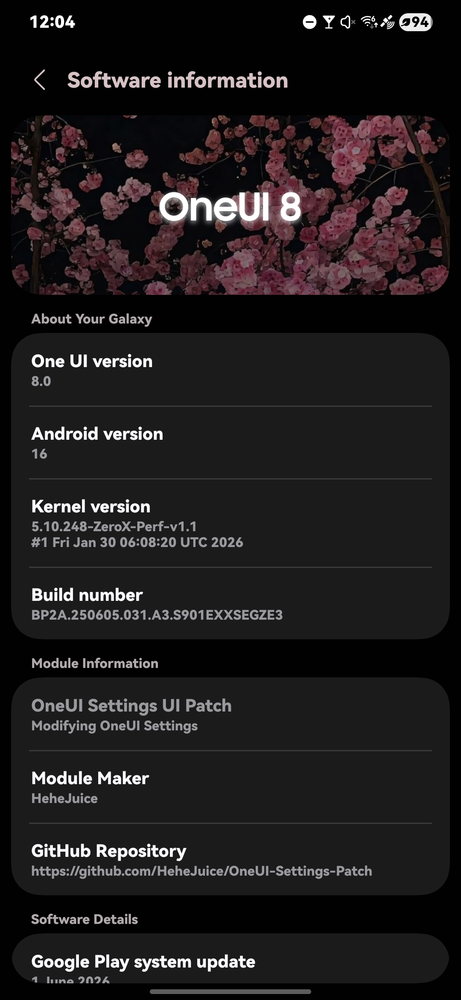
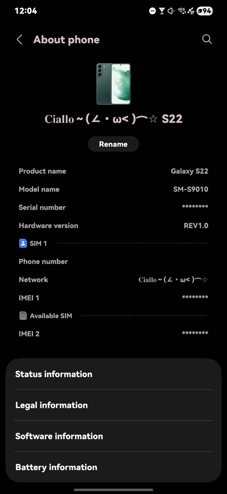
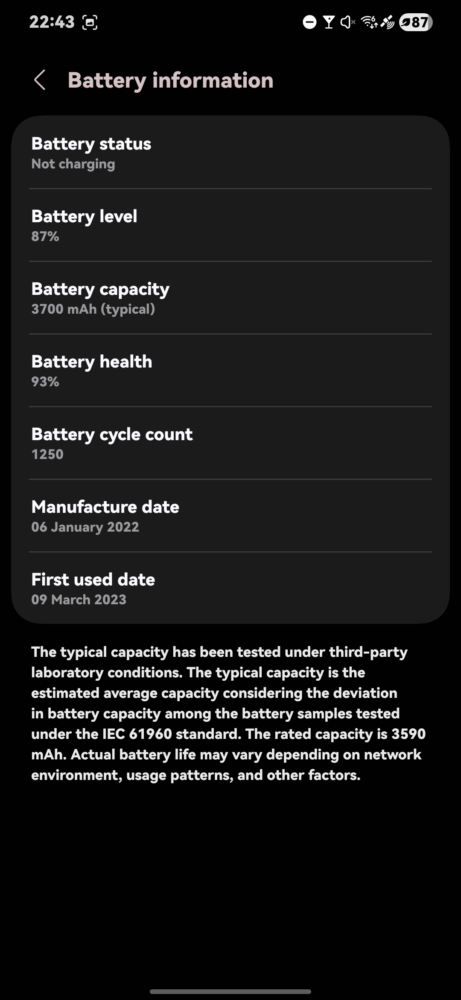
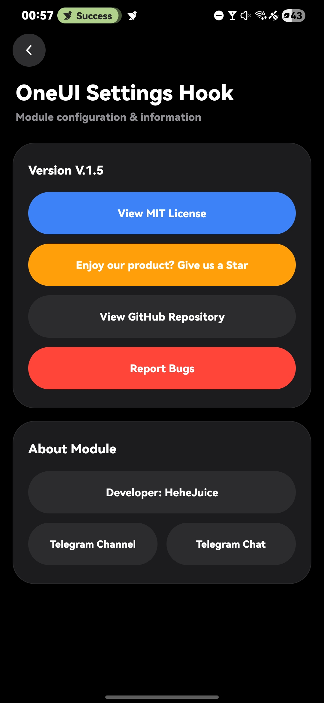
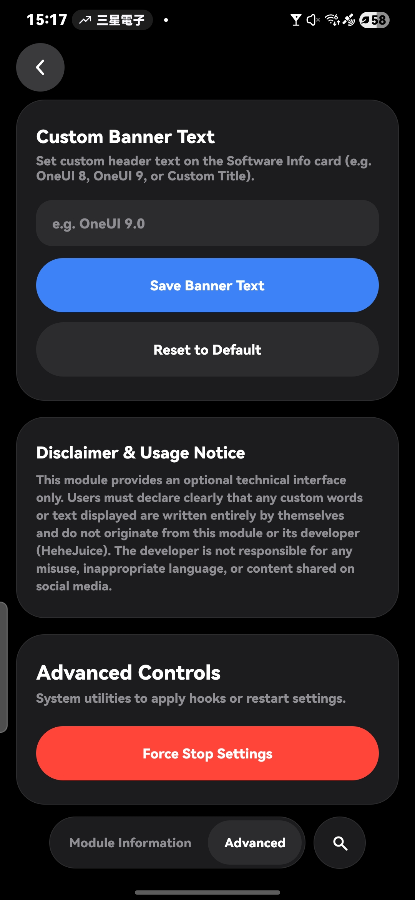
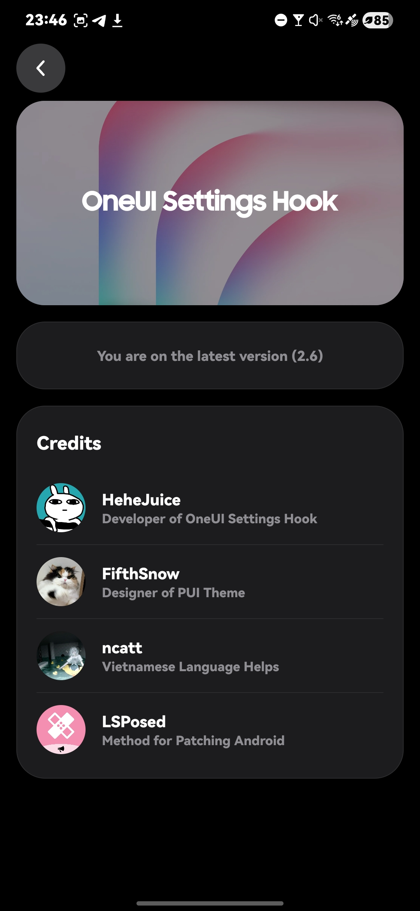

## [English](README.md) / [中文](READMECN.md) / [Tiếng Việt](READMEVI.md) / العربية

<h1 align="center">
  
</h1>

### 🗺 نظرة عامة على المشروع 
- OneUI-Settings-Hook 
- التعديلات تنطبق على تطبيق الضبط لنظام OneUI 7 فما فوق
     - تم اختباره على OneUI 7 ~ 9
- يتطلب أحدث إصدار رسمي من LSPosed وصلاحيات الروت (Root)

### 😶‍🌫️ المميزات 
- ‼️ إعادة تصميم صفحة معلومات البرنامج
     - تأثير توهج متحرك للنص (Glow Text Animation)
     - نصوص قابلة للتخصيص من خلال الإعدادات المتقدمة للوحدة
          - يرجى قراءة قسم "إخلاء المسؤولية وإشعار الاستخدام" في الإعدادات المتقدمة قبل البدء بالاستخدام
     - خلفية بطاقة معلومات البرنامج تطابق خلفية الشاشة الرئيسية
- أيقونات مخصصة للوحة التحكم (Dashboard)
     - OneUI Monet
     - OneUI 6 Monet
     - سمة PUI
- إمكانية تخصيص اسم المنتج (اسم الجهاز)
- حماية المعلومات الحساسة
     - إخفاء تلقائي للبيانات التالية:
          - رقم IMEI
          - الرقم التسلسلي (Serial Number)
          - رقم الهاتف
- إزالة الكشف عن الخطوط المخصصة
     - دعم تثبيت حزم الخطوط المخصصة (APK)
- تعديل يتيح استنساخ جميع التطبيقات (App Cloner)
- فتح معلومات إضافية عن حالة البطارية
- إعدادات الوحدة داخل تطبيق LSPosed

### 📂 معاينة

### ℹ️ طريقة الاستخدام
- قم بتثبيت ملف `APK.` وتفعيل الوحدة داخل LSPosed.
- امنح التطبيق صلاحيات الروت (Root).
- افتح إعدادات الوحدة (من داخل LSPosed) واضغط على "إيقاف إجباري لتطبيق الضبط".
- أعد فتح تطبيق الضبط.
- لم تُطبّق التغييرات؟ افتح تقرير مشكلة (Issue) مع إرفاق تفاصيل نظامك (Software Details).

### 🥰 شكر وتقدير
- داخل التطبيق
