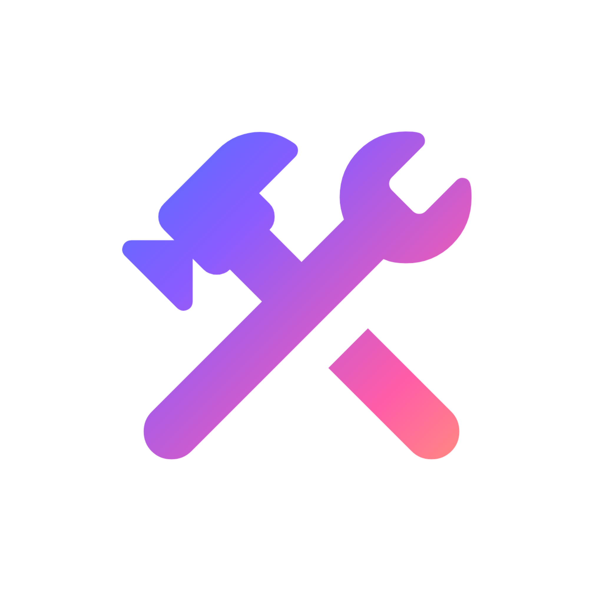
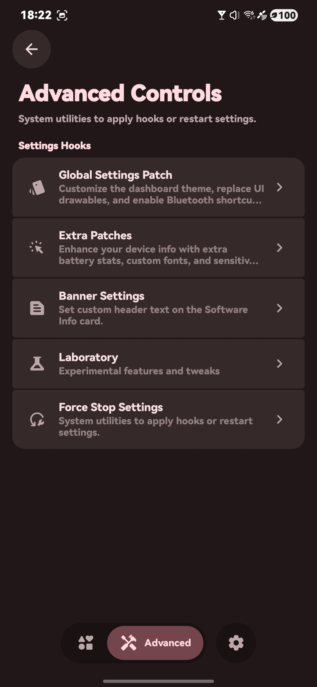
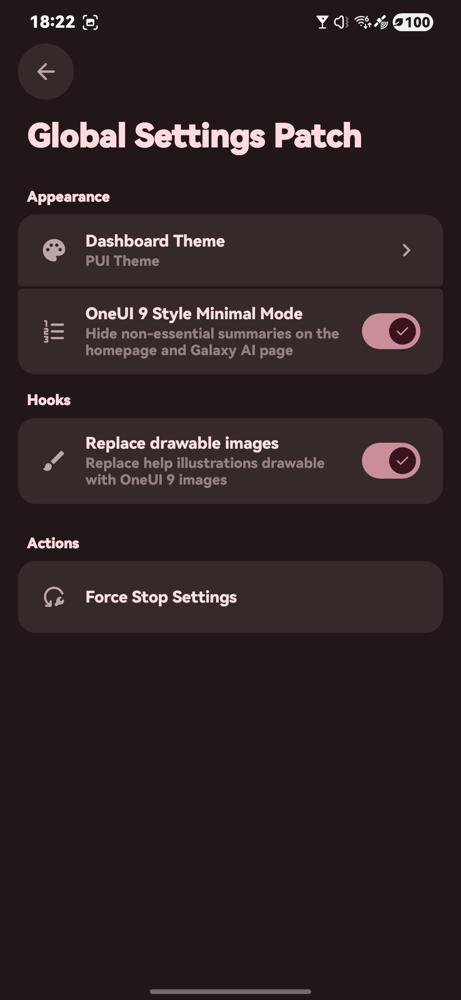
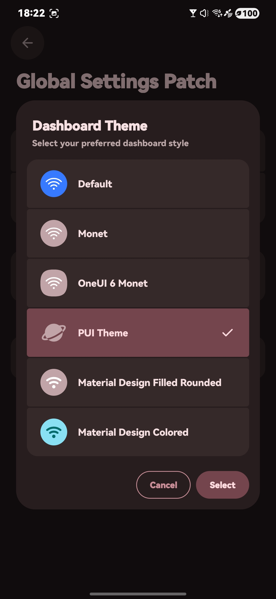
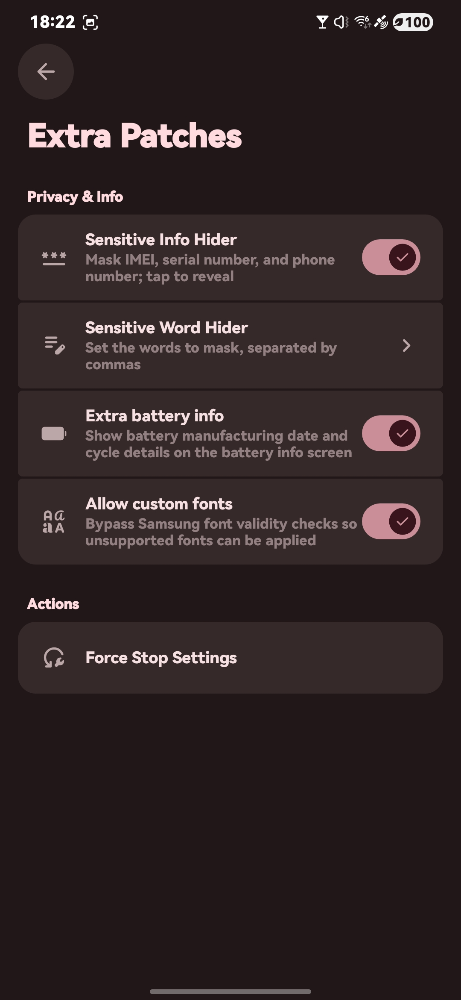
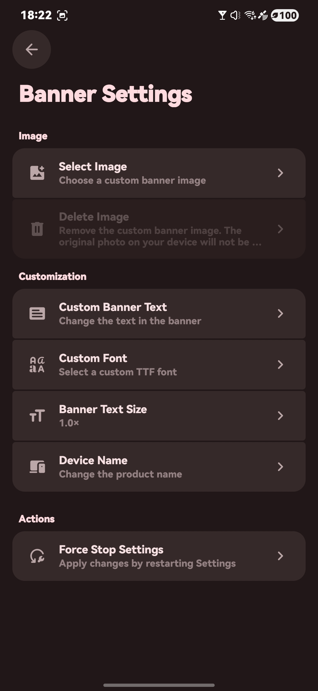
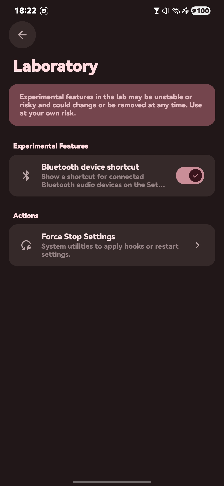
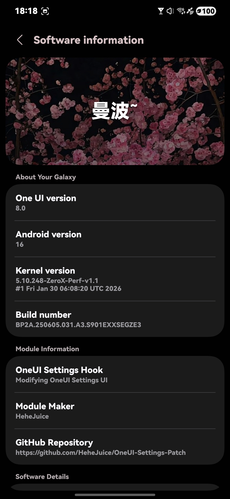
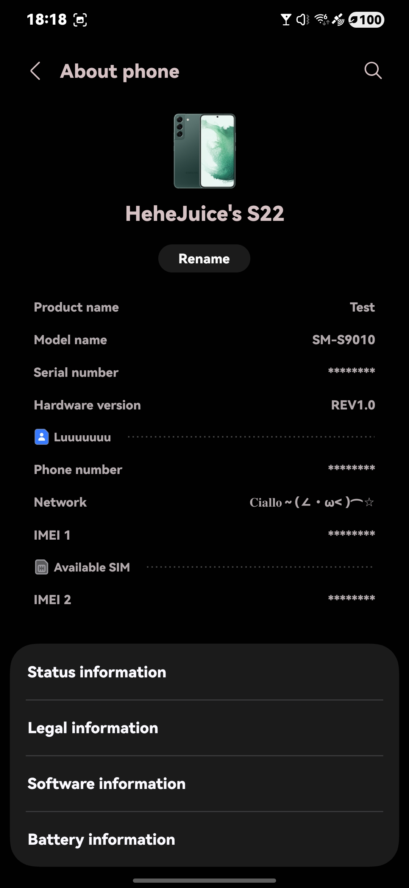
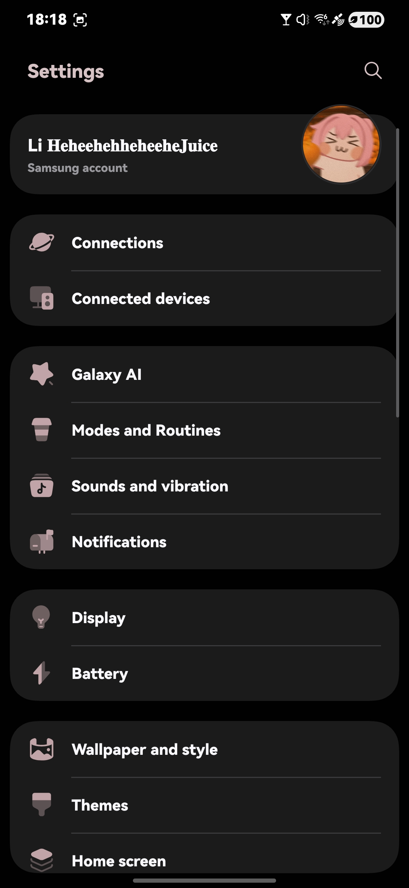

**English** · [繁體中文](README-ZH.md)

---

> This project has fully transitioned to closed source. If you believe applications must be open source, please leave this page to avoid any discomfort—developers are under no obligation to open-source their apps codes.

---

# OneUI-Settings-Hook

> For `One UI 7 and newer`

> Patches for the Settings app on One UI 7+

## Requirements

> Root is required

> LSPosed 2.0.0 or later is required

> Tested on One UI 7 ~ 9

## Features

> ‼️ Redesigned Software Info page
>
> - Text animation
> - Customizable Banner Text, Custom Fonts, and Text Size
> - Custom banner image (pick/delete; falls back to wallpaper)
> - New banner style / redesigned software card
> - Customizable Product Name
> - Software Info card background uses the home wallpaper

> 🎨 Custom Dashboard Icon
>
> - OneUI Monet
> - OneUI 6 Monet
> - PUI Theme
> - MD Theme (Material Design Filled Rounded / Colored)

> 🔒 Sensitive Information Protection
>
> - Auto-hide / mask the following; tap to reveal:
>   - IMEI
>   - Serial Number
>   - Phone Number

> 🔤 Custom Fonts Detection Removed
>
> - Bypasses Samsung font validity checks
> - Supports custom fonts APK

> 📦 Patch to make all apps cloneable
>
> - Bypasses Dual Messenger / App Copy restrictions

> 🔋 Unlock Extra Battery Information
>
> - Show battery manufacturing date and cycle details on the battery info screen

> 🧩 More Settings Patches
>
> - Replace help illustrations with One UI 9 drawables
> - Bluetooth device shortcut on the Settings home page
> - One UI 9 Style Minimal Mode (hide non-essential summaries on homepage and Galaxy AI page)
> - Disable Software Update app
> - Force Stop Settings shortcut

> 🌐 Multi-language UI
>
> - Follow system or choose English, Japanese, Korean, Vietnamese, Chinese variants, Cantonese, etc.

## Screenshots

  
  
  
  

  
  
  
  
  

- Screenshots from OneUI 8 with OneUI-Settings-Hook Applied 

## Downloads

Download the latest APK from the [Releases page](https://github.com/HeheJuice/OneUI-Settings-Hook/releases).

Also available via the [LSPosed Module Repository](https://github.com/Xposed-Modules-Repo/com.HeheJuice.OneUISettingsHook/releases).

The app is distributed as a compiled APK only. No source code is provided.

## License & Privacy

> [License (EULA)](LICENSE)
>
> [Privacy Policy](Privacy_Policy.txt)

> [!NOTE]
> You must agree to and comply with these terms when using or forwarding this content.

## Acknowledgments

<table>
  <tbody>
    <tr>
      <td width="56" align="center" valign="middle">
        
      </td>
      <td valign="middle">
        <a href="https://github.com/HeheJuice"><b>HeheJuice</b></a> 
        Developer of this app
      </td>
    </tr>
    <tr>
      <td width="56" align="center" valign="middle">
        
      </td>
      <td valign="middle">
        <a href="https://github.com/MiToverG422"><b>MiToverG422</b></a> 
        Monet color extraction assistance
      </td>
    </tr>
    <tr>
      <td width="56" align="center" valign="middle">
        
      </td>
      <td valign="middle">
        <a href="https://t.me/PUINewsroom"><b>FifthSnow</b></a> 
        PUI Theme & Resources
      </td>
    </tr>
    <tr>
      <td width="56" align="center" valign="middle">
        
      </td>
      <td valign="middle">
        <a href="https://github.com/dotarma"><b>Dotarma</b></a> 
        Vietnamese Language Helps
      </td>
    </tr>
    <tr>
      <td width="56" align="center" valign="middle">
        
      </td>
      <td valign="middle">
        <a href="https://github.com/material-components"><b>Material Components</b></a> 
        Material Design components used in this app
      </td>
    </tr>
    <tr>
      <td width="56" align="center" valign="middle">
        
      </td>
      <td valign="middle">
        <a href="https://github.com/google"><b>Google</b></a> 
        Material Design icons used in this app
      </td>
    </tr>
  </tbody>
</table>

## Join Us

